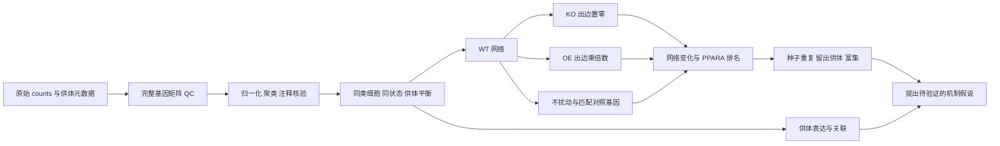

# 从课程代码到可复用单细胞虚拟扰动流程

## 这套方法可以回答什么

在某一细胞类型和疾病状态的表达数据中，先推断基因间网络，再改变 FABP1 的网络连接，检查 PPARA 的网络位置是否发生明显变化。这是基于观察性单细胞数据的机制假说生成方法。没有真实 FABP1 干预数据时，不能把其结果写成“FABP1 敲除使 PPARA 表达下降 X 倍”。

推荐最终研究问题为：**在肝纤维化肝细胞的表达背景下，FABP1 的虚拟网络扰动是否涉及 PPARA，其受影响排名是否跨抽样和供体保持稳定，并且是否与独立的表达、通路和实验观察相容？**

## 原项目思路与保留的主线

原材料有 271 个文件、约 5.03 GB，主线是阿尔茨海默病多队列筛选：bulk GEO 注释/标准化/去批次/差异 → MR 与差异基因交集 → 单细胞定位 → GSN 虚拟 KO/OE → GO/KEGG → v-score/DrugReflector → 对接。bulk、MR、列线图和药物筛选是扩展证据链；当靶点已定为 FABP1 时，不必先走完整候选筛选流程。

## 肝纤维化数据选择

优先选择人肝组织、保留足量肝细胞并含多个独立供体的 scRNA-seq 或 snRNA-seq 数据；要求有原始计数、明确供体及对照/纤维化分组，最好有病因、纤维化分期、年龄、性别和样本处理信息。肝细胞容易在组织解离中受损，某些非实质细胞富集的数据集不适合本问题。单核测序与单细胞测序不能无条件混合。

检查 FABP1 和 PPARA 在每个供体、每类细胞中的检出率、表达分布及变异。FABP1 常见于肝细胞，但不能仅凭该基因给群体贴标签；结合 ALB、APOA1、TTR 等肝细胞程序及胆管、免疫、内皮、间质标志，核验污染和双细胞。肝细胞分区及疾病状态可能同时影响 FABP1/PPARA，需要在可行时分层，而不是把全部肝细胞的相关性直接解释为调控。

默认最少每状态 3 个供体和 200 个 QC 后细胞用于探索性网络分析。这是运行门槛，不是统计功效保证。供体关联默认至少 5 个供体才计算相关性检验；仍需报告效应、样本量和混杂限制。病因、批次与疾病完全混杂时，不应声称已经通过软件消除混杂。

## 数据准备与注释

1. 原始 counts 原样保留。对完整基因矩阵计算每细胞 UMI、检出基因数和线粒体比例，再进行 HVG 选择。`counts ≥500`、`genes ≥200`、`mt ≤20%` 是人肝示例起点，需要结合组织和 scRNA/snRNA 分布调整；原课程的人脑阈值不直接照搬。保存每次改变阈值的理由。
2. 先处理明确双细胞，核查环境 RNA 污染；可通过配置 `doublet_column` 和 `singlet_values` 接入已经审核的双细胞结果。工具不会凭空声称已完成环境 RNA 校正。
3. 使用 Seurat LogNormalize → HVG → ScaleData → PCA → 邻居/聚类/UMAP 完成探索。多样本需要整合时可使用经过检查的 Seurat RPCA/Harmony 表征，只用整合后的降维做邻居图和注释；原始 RNA counts 始终保留供网络使用。不能将疾病效应本身当作批次回归掉。
4. 核验注释后保存 `cell_type`，保留 `sample_id` 与 `donor_id` 的区别。自动注释参考库只能辅助，原课程中脑组织出现 Chondrocytes 等标签也需要复核。
5. 将审核后的对象或计数文件与元数据交给运行脚本。本版不自动猜测细胞类型；缺失注释时给出明确状态，先完成注释再建网。

## 网络与扰动

每个“细胞类型 × 状态”独立分析。先按供体形成相同细胞数的候选池，再使用官方引擎有放回抽样构建子网络；候选池按供体平衡，单个子网络的供体数量仍有抽样波动。保存实际候选细胞清单，官方固定 seed 可复现内部抽样。

默认 3,000 个 HVG，排除线粒体及核糖体基因作为一般候选；只要目标/关注基因有足够检出和变异，强制纳入。每次留出供体后重新选择 HVG，避免被留出的供体参与该次网络特征选择。模型实际基因集会随留出供体变化，比较共同基因的排名并检查该变化。

当前固定引擎对选定基因的 counts 先做 CPM，再进行逐基因标准化的主成分回归，构造 10 个子网络，随后张量分解得到 WT。这里的 WT 指该状态下未经模拟修改的基线，既可来自正常组，也可来自纤维化组。因为 CPM 分母是模型输入的基因集合，HVG 数量也是模型敏感性来源；正式研究可在主分析后预先设计 2,000/3,000/5,000 基因的敏感性分析，不能只报告最有利的设置。

scTenifoldKnk 将处理并转置后的 WT 目标行置零。自定义 OE 在同一 WT 上把该行乘以 2、5、10。两者保留同一基线、基因集与流形参数。因 FABP1 是脂肪酸结合蛋白而非典型转录因子，网络出边表示统计依赖，不等于直接转录调控边；涉及 PPARA 的效应可能经过脂质配体、代谢或其他间接环节。

每个种子同时计算：目标 KO、目标 OE、factor=1 不扰动，以及按表达均值和检出率匹配的对照基因 KO。匹配对照用于比较通用网络敏感性，不能视为已知“没有生物学作用”的阴性基因。所有结果保留，无出边时直接标为 `unchanged_network`，不将数值噪声排序为有效生物信号。

## 结果与结论层次

| 证据 | 主要输出 | 合理表述 |
|---|---|---|
| 虚拟网络响应 | distance、网络 FC、排名、模型 FDR | PPARA 的网络位置对指定扰动敏感/未发现稳定变化 |
| 稳定性 | 5 个种子、供体留一、匹配基因对照 | 结果是否依赖个别供体或随机抽样 |
| 观察表达 | 供体 pseudobulk log1p CPM、状态内 Spearman | FABP1 与 PPARA 在供体间呈正/负关联；不能等同干预效应 |
| 功能程序 | 有来源的 PPARA 靶基因或 FAO 签名评分 | 观察性靶基因程序代理；不等同 PPARA 蛋白活性 |
| 实际干预 | KO/KD/OE 对照数据及外部验证 | 在实验条件下估计方向和表达响应 |

原始网络距离取决于流形和数据尺度。不同状态/供体网络不直接相减距离、FC 或 P 值；优先看关注基因的百分位排名、是否可评估、对照分布及稳定性。种子显著比例只是算法稳定性，不是生物学发生率。模型 FDR 不涵盖无限尝试细胞类型、靶点、倍数后的选择偏差，应预先规定主靶点、细胞类型和主要设置。

富集使用第一枚预先指定的种子、全供体结果，排除被机械扰动的目标基因，使用实际建网且成功映射的背景。GO/KEGG 分别进行 BH 校正；无符号网络结果不标成“激活/抑制通路”。空结果正常输出。KEGG 使用用户指定的有版本 GMT 快照，缺失时明确标记未运行。

## 后续实验和预测模型的衔接

若想回答 FABP1 改变后 PPARA 究竟升高还是降低，需要匹配的 FABP1 KO/KD/OE 与对照数据，或经过肝细胞及相关状态外部验证、确实支持该扰动的模型。验证应留出供体/实验批次，比较简单均值/共表达基线，明确读出时间、扰动效率及培养条件。通用细胞系模型对肝纤维化组织的迁移不能默认有效。

可分别测定 FABP1 扰动效率、PPARA mRNA、PPARα 蛋白及相关转录程序；必要时做 PPARA 干预/拯救设计以区分通路关联与功能依赖。选择何种实验取决于具体假说。本 Skill 不预设 FABP1 在 PPARA 上游，也不要求 KO 与 OE 对称。
